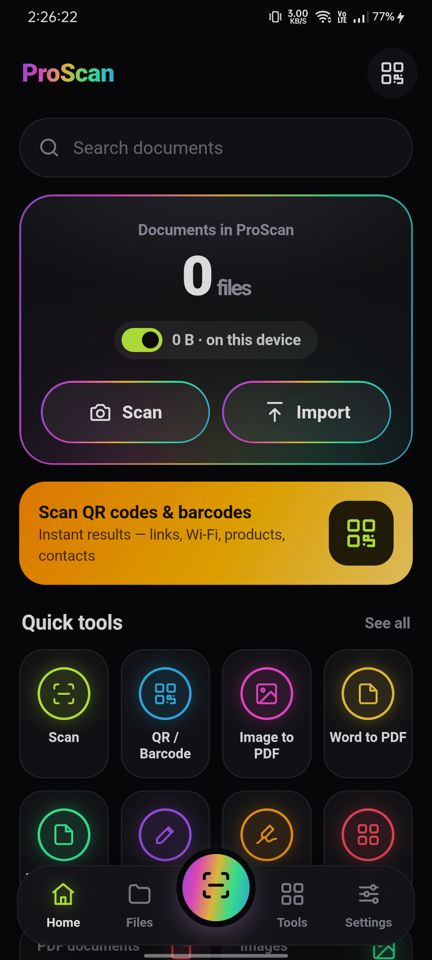
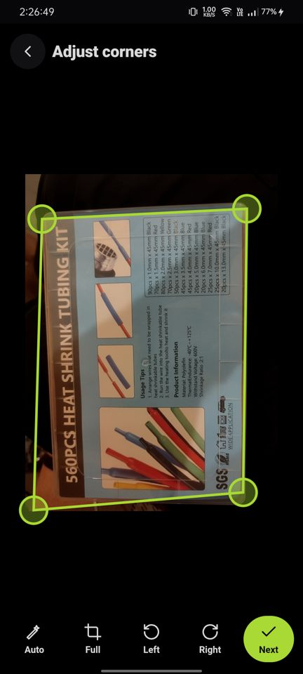
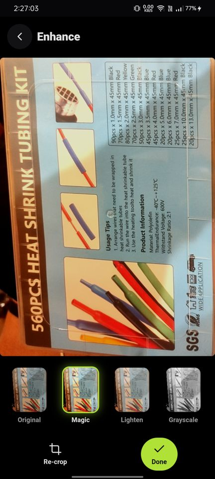
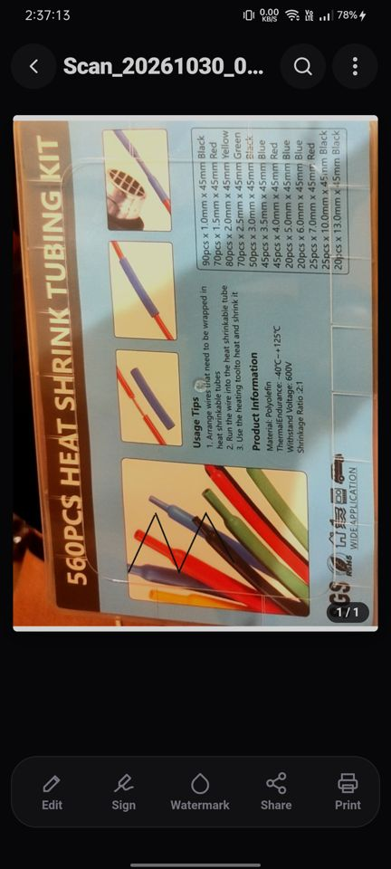

# ProScan : Doc, PDF

**Scan, convert, edit and sign documents on Android — everything runs on your phone.**

**[⬇ Download the APK](https://github.com/Janardanpal007/proscan-doc-pdf/releases/latest/download/ProScan-Doc-PDF-v1.0.apk)** · **[Website](https://janardanpal007.github.io/proscan-doc-pdf/)** · **[Try it in your browser](https://janardanpal007.github.io/proscan-doc-pdf/app/)**

<p>
   
</p>

## Features

| Area | What you can do |
|---|---|
| 📷 **Scan** | Camera to PDF with live edge detection, drag-to-adjust corners, perspective correction, Magic / Lighten / Grayscale / B&W filters, multi-page scans |
| 🔳 **QR & barcodes** | Live camera or from a photo; links, Wi-Fi (shows password), contacts, EAN/UPC/Code 128…; history |
| 🔄 **Convert** | Word ↔ PDF, Image ↔ PDF (ZIP export), Excel → PDF, PowerPoint → PDF |
| ✏️ **Edit** | Text, pen, highlight, rectangles, circles, lines, arrows, images, undo/redo |
| ✍️ **Sign** | Draw or type a signature, save it for reuse, place / move / resize |
| 💧 **Watermark** | Text watermark — center, tiled, top or bottom, with live preview |
| 🛠️ **PDF tools** | Merge, compress, extract / split pages, organize (reorder, rotate, delete), lock & unlock (AES-256), print |
| 📁 **Files** | Recents, search, sort, folders, favorites, rename, move, share, save to Downloads |

Private by design: no account, no cloud, no ads — files never leave the device.

## Install

1. Download `ProScan-Doc-PDF-v1.0.apk` from [Releases](https://github.com/Janardanpal007/proscan-doc-pdf/releases).
2. Open it on your Android phone (5.1+) and allow installing from that source.
3. Launch ProScan and allow camera access.

## Build from source

The app is a web app (`www/`) packaged for Android with [Capacitor 6](https://capacitorjs.com/). All PDF and image processing runs on-device with pdf.js, pdf-lib, jsPDF, mammoth, SheetJS, docx and ZXing (vendored in `www/vendor/`).

Requirements: Node 18+, JDK 17, Android SDK (platform 34, build-tools 34).

```bash
npm install
npx cap sync android
cd android
./gradlew assembleDebug        # app/build/outputs/apk/debug/app-debug.apk
```

For a signed release build, create `android/keystore.properties` (not committed):

```
storeFile=../your-release.jks
storePassword=…
keyAlias=…
keyPassword=…
```

then run `./gradlew assembleRelease`.

| Path | Contents |
|---|---|
| `www/` | The app (HTML/CSS/JS, screens in `www/js/screens/`) |
| `android/` | Capacitor Android project; native plugin in `ProScanNativePlugin.java` (save to Downloads, share, print, open links) |
| `docs/` | Website served by GitHub Pages (`docs/app/` is the browser demo) |

---

Built by **Janardan / TSE**.
